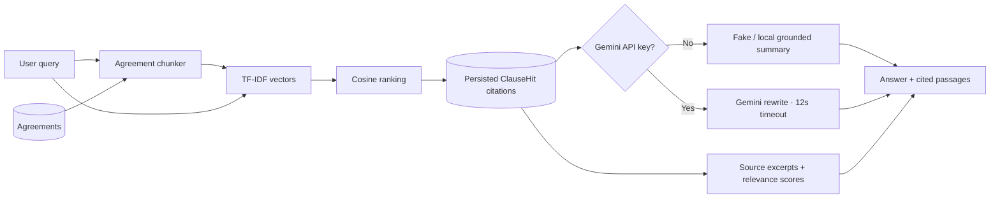

# Clause Finder

Clause Finder is a small contract-research demo: choose a fictional agreement or paste plain text into the local workspace, ask for a clause in plain English, and inspect the source passages ranked as relevant. It uses section-aware text chunks and TF-IDF cosine similarity, so every result can be traced to its agreement, section label, and original excerpt.

> **Research aid only.** The sample agreements are fictional, this demo is not legal advice, and results should not be used to make legal decisions. Do not upload confidential or personal information.

## How the AI design works



The retriever is deterministic and runs locally. It chunks agreement text around numbered sections, builds TF-IDF vectors for the query and passages, computes cosine similarity, and stores ranked matches as `ClauseHit` records. The optional LLM receives only the top retrieved passages and is instructed not to introduce unsupported terms. If Gemini is unavailable or fails, the app returns a local fallback answer alongside the same source citations.

## Run locally

Requirements: PHP 8.3+, Composer, Node.js 22+, and SQLite (included with PHP).

```bash
composer install
cp .env.example .env
php artisan key:generate
```

Configure `.env` to use SQLite (the starter defaults to it), then migrate and seed the fictional Harbor Desk MSA, NDA, and SLA:

```bash
php artisan migrate --seed
npm install
npm run dev
```

In a second terminal, start the Laravel server:

```bash
php artisan serve
```

Open <http://127.0.0.1:8000>. No sign-in or API key is needed. Without `GEMINI_API_KEY`, search and cited retrieval work normally using the local fake LLM adapter. To enable optional answer rewriting, set `GEMINI_API_KEY` (and optionally `GEMINI_MODEL`, default `gemini-2.0-flash`) in `.env`, then restart the app. Gemini requests have a 12-second timeout and fall back to the local answer on provider errors.

The seed command is safe to run repeatedly: the three sample agreements are updated by title. All seeded examples are fictional and use only the Harbor Desk name. Pasted agreements are stored in the local database; do not paste confidential or personal information.

## Tests

```bash
php artisan test
```

The Pest/PHPUnit suite verifies that “limitation of liability” retrieves and persists a relevant MSA excerpt, guests can paste and search an agreement without signing in, `FakeLlmClient` is bound when no API key is configured, LLM outages fall back without a 500, and TF-IDF ranks matching passages ahead of unrelated text.

## Stack

- Laravel 13 and PHP 8.3+
- Vue 3, Inertia, TypeScript, and Tailwind CSS
- SQLite for local development
- TF-IDF and cosine similarity implemented in PHP
- Optional Gemini API behind `App\Services\Llm\LlmClient`
